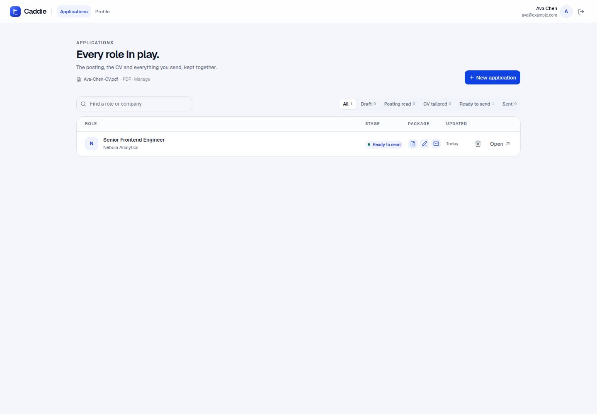
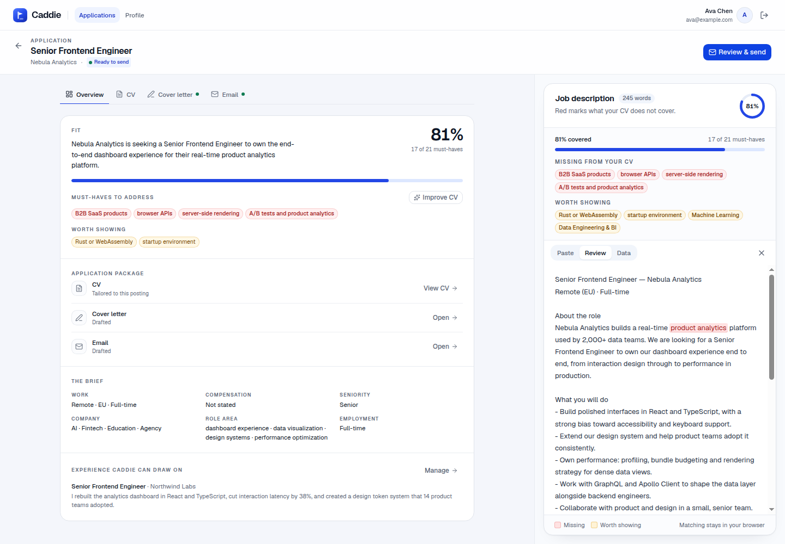

# Caddie

Paste a job description, see what your CV already covers, then build the
application around it: tailor the CV, draft the cover letter and email, and send
it from your own address. Every role keeps its posting, CV snapshot, drafts and
completion state together, and both documents stay downloadable.





## Run it

Requirements: Bun, Node for the frontend tooling, LibreOffice (`soffice`) for
DOCX rendering, poppler (`pdfinfo`/`pdftotext`) for the fit assistant and draft
grounding, and MongoDB (Atlas or the local Docker container below).

```bash
npm install
cp .env.example .env.local
# Fill in CF_ACCOUNT_ID, CF_API_KEY, BROWSERBASE_API_KEY,
# MONGODB_URI, BETTER_AUTH_SECRET, BETTER_AUTH_URL and APP_ENCRYPTION_KEY.
npm run dev
```

For local development, MongoDB can run in Docker:

```bash
docker run -d --name caddie-mongo -p 127.0.0.1:27017:27017 \
  -v caddie-mongo-data:/data/db mongo:latest
```

Set `MONGODB_URI=mongodb://127.0.0.1:27017/caddie` (or use an Atlas connection
string). Generate `BETTER_AUTH_SECRET` and `APP_ENCRYPTION_KEY` with
`openssl rand -base64 32`.

Google sign-in is the only auth path. In Google Cloud Console → APIs & Services
→ Credentials, add this Authorized redirect URI:

```
${BETTER_AUTH_URL}/api/auth/callback/google
```

For local development with the Vite port that is
`http://localhost:5173/api/auth/callback/google`. Copy the Google client ID and
secret into `.env.local` as `GOOGLE_CLIENT_ID` / `GOOGLE_CLIENT_SECRET`.
`BETTER_AUTH_API_KEY` is only for `@better-auth/infra` and is not needed here.

Email sending is per user. Add a sending identity in Profile: from address,
sender name and a Resend API key. The name is prefilled from your account and
stays editable. Caddie checks that Resend has verified the address's domain
before saving the key; the key is encrypted with `APP_ENCRYPTION_KEY`. Once
saved, the key input disappears, and the identity can be edited or removed. To
replace the key, remove the identity and add it again.

Open <http://localhost:5173>, continue with Google, upload your CV in Profile,
then paste a job description to create an application.

```bash
npm run build    # typecheck + production build
npm run preview  # serve the build
npm run lint
npm run eval     # score Gemma/JEV against eval/corpus.ts
```

## What's here

- **Applications table** — every role in one ledger: stage, package state, last
  updated and the next action. Search by role or company and filter by stage.
  Completed and sent applications stay visible and downloadable.
- **Application workbench** — open a role to see the fit and the application
  package before the raw CV. Tabs hold the Overview, CV, Cover letter and Email;
  the posting stays alongside with its coverage marks and company research.
- **Profile** — the base CV, the experience library, and the sending identity.
  Experiences are your own words about work you actually did; they ground CV
  bullets, cover letters and email drafts. The sending identity is a saved
  connection, not an empty form: once added, Profile shows the from address,
  verified domain and key suffix, with Edit and Remove actions.
- **Cover letter and email** — Caddie first picks the story: a direct project
  match, a similar problem, a craft angle or an honest transferable angle, with
  one hero proof and one supporting proof. It then writes from those selected
  facts rather than reciting the CV. The draft is editable, saved to the
  application, and never sent without a confirmation. An application address
  found in the posting is prefilled into the email recipient and marked "From
  posting."
- **Send from your own address** — connect Resend in Profile. Sending attaches
  the application's PDF, records the recipient and time, and never auto-sends.
  The cover letter stays a separate draft; it is not automatically attached.
- **Complete and lock** — mark an application complete without sending, or send
  it. Either action locks the CV, cover letter, posting and email against further
  edits, while the package stays readable and downloadable.
- **Downloads** — the tailored CV is downloadable as its application PDF, and
  the cover letter is rendered server-side to a PDF. Both downloads work after
  the application is locked.
- **Your CV** — upload a DOCX or PDF. The file and its rendered PDF live in your
  account (MongoDB GridFS). A DOCX keeps its fonts and can be tailored; a PDF is
  read-only. Replacing the base CV does not rewrite existing application
  snapshots.
- **Matching** — `src/lib/match.ts` scores the classified must-haves against the
  CV text. Single-word terms use the CV vocabulary, multi-word terms must appear
  as a phrase, and either-or groups are covered by any alternative. Missing
  must-haves turn red; nice-to-haves and implied signals turn amber and never
  change the score. Matching is instant and runs in the browser.
- **CV planner** — open it from **Improve CV** or a gap chip. Caddie shows the
  missing skills and one text box: tell it what you have actually done, mentioning
  companies or projects. It maps roles, projects and project bullets, marks the
  blocks that are protecting must-haves, and proposes up to three line-neutral
  replacements. A project can be nested under the role where it was built. If a
  project or product is unknown, it asks instead of guessing. Nothing is applied
  until you approve the plan.
- **CV map** — open **Structure** in the CV tab to see what Caddie read: roles,
  projects, project bullets and whether each block is protected, worth showing,
  generic or safe to swap.
- **DOCX under the hood** — `/api/cv/edit` replaces anchored text while
  preserving the original run formatting (font, size, weight), then re-renders.
  `/api/cv/classify` extracts contact, summary, roles, projects, project bullets,
  education and skills with an anchor back to every editable field. The default
  read is structural: rules parse the DOCX blocks and Clef-flash labels only the
  ambiguous ones, so it takes about a second and generates no text. `?mode=deep`
  is a manual Gemma read for unusual layouts.
- **Company research** — Browserbase searches and reads public pages, then
  extracts a profile (summary, sectors, founders, stage, funding, links,
  signals) with its JSON extraction. It never sees the CV and uses no Gemma
  tokens.

## Privacy

Your CV, applications, experiences and sending settings are stored in your
account (MongoDB). Caddie sends the posting text to Cloudflare Workers AI for
classification, and the CV/JD/experiences to Gemma when you draft a cover letter
or email or use the CV planner. Company research sends only the company name,
role fields and a one-line summary to Browserbase, never the CV. When you send an
application, Resend receives the from and to addresses, the email text and, when
attached, the CV PDF. The Resend key is encrypted at rest with
`APP_ENCRYPTION_KEY`; only its last four characters are returned to the browser.
Matching stays in the browser.

Built with Vite, React, Tailwind CSS v4, shadcn/ui, Better Auth, Bun/Hono,
MongoDB, Resend and Cloudflare Workers AI. Design and engineering conventions
are in [AGENTS.md](AGENTS.md).
