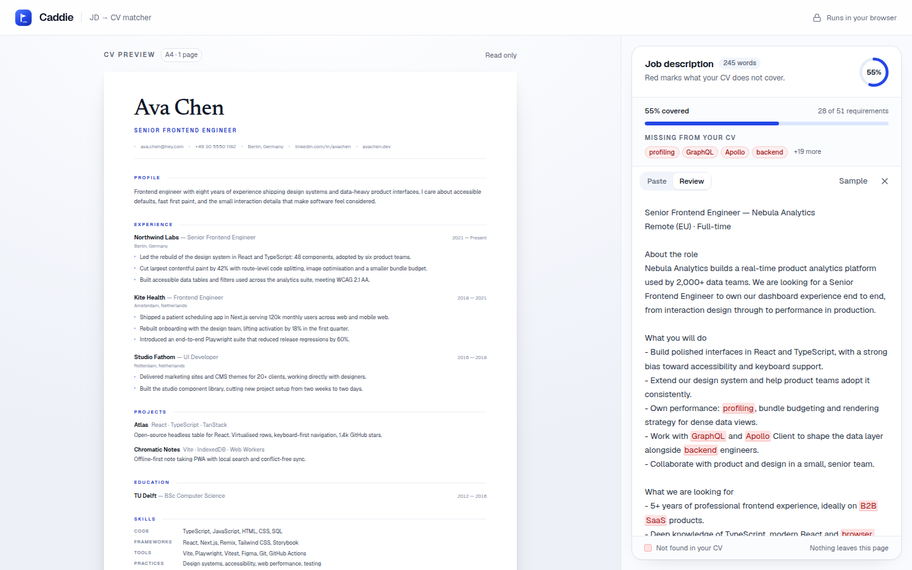

# Caddie

Paste a job description, see how much of it your CV already covers. Missing
requirements are highlighted in red on the posting itself.



## Run it

```bash
npm install
npm run dev
```

Then open <http://localhost:5173>. Click **Upload CV** to load your own PDF, or
click **Try a sample role** in the job description panel to see the matcher
working on the sample profile.

```bash
npm run build    # typecheck + production build
npm run preview  # serve the build
npm run lint
```

## What's here

- **Your CV** — upload a PDF and it is drawn page by page at the width of the
  pane, with arrows to move between pages. Its text stays selectable and
  copyable. Until you upload, a sample CV is shown, authored at 794×1123px and
  scaled so its layout is identical at every viewport.
- **Job description panel** — paste, review, and edit modes. Coverage and gaps
  update as soon as text arrives.
- **Matching** — a deterministic, client-side matcher over a curated skills
  lexicon (`src/lib/skills.ts`). It reads the text of the CV on screen: an
  uploaded PDF's extracted text, or the sample. No network calls, nothing
  leaves the page.

Built with Vite, React, Tailwind CSS v4 and shadcn/ui. Design and engineering
conventions are in [AGENTS.md](AGENTS.md).
